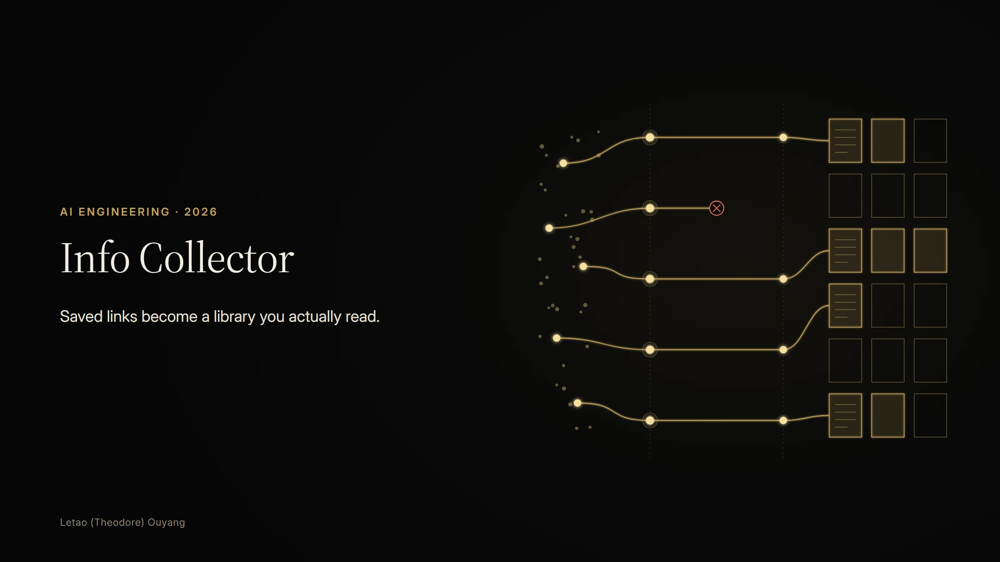
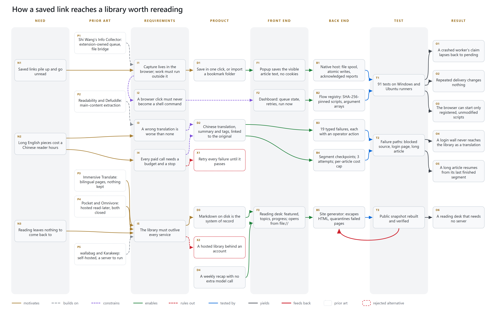

# Info Collector

**Letao (Theodore) Ouyang** · Product, front end, back end and tests · July – November 2026 · Built on [Shi Wang's Info Collector](https://github.com/aswrise/info-collector)

[Reading desk](https://www.theodoreoy.com/ENGINEERING-Info-Collector-2026/) · [Engineering route](docs/engineering-route.md) · [Prior art](docs/prior-art.md) · [Architecture](docs/ARCHITECTURE.md) · [Operations](docs/OPERATIONS.md)

**How do the articles you save become a library you actually read, when the browser can capture but cannot work, and a model can translate but cannot be trusted?**

Saving an article costs one click. Reading a long English piece costs a Chinese reader an hour, so saved links pile
up and are never opened. I built a Windows product that closes the gap: a Chrome extension captures the page, a local
worker turns it into a Chinese translation with a summary and topic tags, and every article lands as a Markdown file
on the reader's own disk, with a reading desk generated from those files that opens without a server. The hard part
is the boundary in the middle. The browser that captures cannot run work, the machine that runs work cannot see the
browser, and the model between them fails in many ways. I made every crossing of that boundary atomic and idempotent,
and gave every failure a name: **19 typed failure codes**, each with an operator action, so a login wall never
reaches the library as a translation. **91 tests** run on Windows and Ubuntu.

## Three results to start with

| Result | Why it matters | Where |
| --- | --- | --- |
| A login wall, a paywall or a refused request ends in a typed failure, and the model is never called for it | The reader relies on the translation because the original is costly to read, so a wrong translation is worse than none | [Worker](flows/translate-claude-api.py) · [tests](test/translate_flow_backend_test.py) |
| A worker that dies mid-run loses nothing: its claim lapses back to pending, a repeated report changes nothing, and a long article resumes from its last finished segment | Work crosses two processes with no database between them | [Queue](extension/lib/queue.js) · [host](host/info_collector_host.py) · [tests](test/queue.test.js) |
| A button in the browser can start only a registered script whose SHA-256 matches | The browser triggers processes on the machine; the host, never the browser, decides what runs | [Host](host/info_collector_host.py) · [tests](test/host_test.py) |

## The problem

Technical readers save far more than they read. A bookmark has no state, no summary and no deadline, and the best
writing in AI and engineering is long-form and in English. For a reader whose first language is Chinese, every saved
piece is an hour-long commitment before it can even be judged, so the pile only grows.

The tools that exist each solve a slice. Read-later services keep the list but not the language, and they close:
Omnivore's hosted service shut down in November 2024 and Pocket in July 2025, leaving export as the only way to keep a
library. Self-hosted tools such as wallabag and Karakeep keep the data but need a server. Bilingual translation
extensions translate the page in front of the reader and keep nothing. What the reader needs is one loop: **collect**
in one click, **understand** in a minute, **organize** by topic and progress, **keep** forever, and **review** the
week. [Prior art](docs/prior-art.md) sets each of these tools against that loop.

## The hard part

Three boundaries decide whether the loop can be trusted.

**The browser and the machine.** A Manifest V3 extension can capture a page but cannot run a ten-minute job, hold a
model key or write files. Local scripts can do all three but cannot see the browser. The bridge is Chrome native
messaging and a file spool: the extension owns the queue, writes pending lists to an outbox through a native host, and
reads completion reports from an inbox. Every file is written to a temporary name and renamed, a report is archived
only after the extension acknowledges it, and reports are applied by normalized URL, so the same report delivered
twice changes nothing. A worker claims its articles before it starts; if it dies, the claim lapses and the articles
return to pending without counting as failures.

**Trust.** Web pages and model answers are untrusted input. Main-content extractors return the main block of whatever
page they receive, login walls included, and a model can return malformed or partial output. A quality gate follows
extraction, every way a run can stop has a code, a stage, a retryable flag and an operator action, authorization
outcomes are never retried anonymously, and no failure ever produces a placeholder translation. The site generator
escapes raw HTML, admits only http and https links, and holds an article without a publishable translation in a
recovery queue.

**Cost.** Every translation is a paid call. Only retryable failures are retried, three times with backoff; each
article has a hard input budget; a run takes at most 20 articles; and long articles are translated in
48,000-character segments saved as checkpoints, so an interrupted article never pays twice.

## The design

| Layer | What I built | What it buys |
| --- | --- | --- |
| Product | Collect, understand, organize, keep, review; a Markdown file per article as the system of record; a weekly recap built from finished summaries and tags | The library outlives any service, and the recap costs no model call |
| Front end | A popup that saves the visible article text on a click, with no cookies or headers copied; a dashboard with per-type state, retries, run-now controls and quota; a reading desk with featured pieces, a recovery queue, topics, favorites, progress and a six-week reading chart | Pages the reader is signed in to can be saved safely, and the library is browsable from `file://` |
| Back end | A native host that moves files and starts only hash-pinned flows; a translation worker for DeepSeek or Anthropic models with typed failures, checkpoints and budgets, keys sealed with Windows DPAPI and a public-address check repeated after every redirect; a deterministic site generator | Exactly-once effects without a database, no command channel from the browser, bounded cost |
| Tests | 49 Node and 42 Python tests in CI on Windows and Ubuntu, a PowerShell installer syntax check, and a rebuilt-and-verified public snapshot | Every rule above is enforced on every change |

The Node side has no third-party runtime dependency and the Python flows use the standard library. New processing
types enter through a registry, so a transcript or book flow plugs into the same queue without touching its state
machine.

## What is new

The queue owned by the extension and the file bridge come from Shi Wang's macOS Info Collector. What I built on them:

1. **A bridge with no command channel.** The browser names a processing type; the host alone decides what runs, from
   a registry pinned by SHA-256 and started with argument arrays, never a shell.
2. **A failure taxonomy for capture and translation.** 19 codes across source, extraction, model and translation,
   each with an operator action, so every stopped article says what to do next.
3. **Exactly-once effects without a database.** Atomic writes, acknowledged reports, idempotent application and
   claims that lapse when a worker dies.
4. **Bounded cost.** Retries only where a retry can succeed, a per-article budget, and checkpointed segments.
5. **A library that is only files.** Reading desk and weekly recap are generated from Markdown and open without a
   server; the public desk is the same generator's output.

## How it was built

<picture>
  <source media="(prefers-color-scheme: dark)" srcset=".github/readme/route-dark.png">
  
</picture>

The route runs from need to result, and one test went back and changed the design.

- **One bridge.** Capture stays in the browser and everything slow leaves it, over a spool that survives crashes and
  repeats.
- **No command channel.** Once the browser can start work on the machine, the host decides what work exists.
- **A translation the reader can trust.** A reader who cannot read the original cannot check the translation, so
  every failure is named and none is dressed up as a result.
- **A library that outlives every service.** Rebuilding the public snapshot exposed an article published without a
  usable translation; that result went back into the generator, which holds empty and incomplete translations in a
  recovery queue.

The [engineering route](docs/engineering-route.md) explains all 36 steps and all 37 links.

## Repository

| Path | Contents |
| --- | --- |
| [`extension/`](extension/) | Chrome extension: queue, storage codec, importer, popup and dashboard |
| [`host/`](host/info_collector_host.py) | Native-messaging host and flow registry |
| [`flows/`](flows/) | Translation worker, reading-site generator, weekly recap and podcast flow |
| [`reader/`](reader/) · [`site/`](site/) | Reading desk front end and its public snapshot |
| [`test/`](test/) | Node and Python test suites |
| [`docs/engineering-route.md`](docs/engineering-route.md) · [`docs/prior-art.md`](docs/prior-art.md) | The route as a network, and the prior art |
| [`docs/ARCHITECTURE.md`](docs/ARCHITECTURE.md) · [`docs/design.md`](docs/design.md) · [`docs/OPERATIONS.md`](docs/OPERATIONS.md) | Architecture, design and operations |
| [`docs/SETUP-WINDOWS.md`](docs/SETUP-WINDOWS.md) | Windows setup |

Released under the [Apache 2.0 license](LICENSE); [third-party notices](docs/THIRD_PARTY_NOTICES.md).
