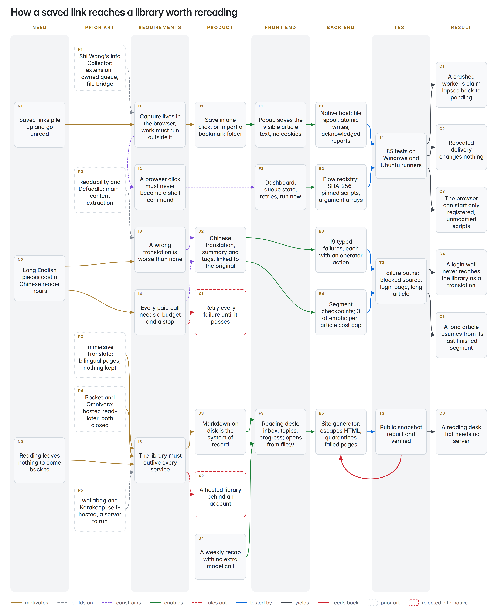

# Engineering route

How the product was built, from the need to the result: which need forced which requirement, what prior work each
decision stands on, how product, front end and back end divide the work, what the tests check, and where a test
went back and changed the design.

<picture>
  <source media="(prefers-color-scheme: dark)" srcset="../assets/route-dark.png">
  
</picture>

## Reading the figure

Columns run from need to result, the order in which a product is reasoned about. A link can run between any two
columns, and one runs backwards, from a test to the design.

| Link | Meaning |
| --- | --- |
| motivates | A need or a requirement that made the next step necessary |
| builds on | Prior work the step starts from |
| constrains | Something that limits what a step may do |
| enables | A decision that makes a component possible |
| tested by / yields | A component and the suite that checks it; a suite and what it establishes |
| feeds back | A test result that changed the design |
| rules out | A requirement that excludes an alternative |

Solid boxes are my own steps. Dotted boxes are prior art, and red dashed boxes are alternatives I rejected.

## The four threads

### 1. One bridge between the browser and the machine

N1, P1 → I1 → D1 → F1 → B1 → T1 → O1, O2.

Saving an article is a gesture in a browser tab, and everything that makes a saved link worth opening happens
somewhere else (I1): extraction and translation take minutes, need a model key and write files, and a Manifest V3
extension can do none of that. Shi Wang's Info Collector (P1) had already drawn the right line: the extension owns
the queue, and local scripts do the work, exchanging pending lists and completion reports with it through files and
Chrome native messaging. I kept that line and built the Windows product on it.

Capture stays one click (D1). On an explicit click the popup takes the visible article text, so pages the reader is
already signed in to can be saved without copying a cookie or an authorization header (F1). The snapshot travels
through the native host, which checks its size, URL and protocol again and writes it to the spool (B1). Every file
is written to a temporary name and renamed, a completion report is archived only after the extension acknowledges
it, and reports are applied by normalized URL, so delivering one twice changes nothing. A flow claims its articles
before it starts; if it dies without reporting, the claim lapses on the next sync and the articles return to
pending without counting as failures (T1 → O1, O2).

### 2. A browser click that cannot become a command

I1 → I2 → F2 → B2 → T1 → O3.

Once a button in the browser can start work on the machine, the browser side becomes an attack surface (I2). The
dashboard's run-now control names a processing type and nothing more (F2). The host looks the type up in a local
registry, checks that the script sits in a trusted directory and that its SHA-256 matches the registered value, and
starts it with an argument array, never through a shell (B2). A modified or unregistered script is refused (T1 →
O3).

### 3. A translation the reader can trust

N2, P2 → I3; N2 → I4; I3, I4 → D2 → B3, B4 → T2 → O4, O5; I4 rules out X1.

A Chinese reader saves an English article because reading the original is expensive, which is exactly why the
reader cannot check the translation against it (I3). Main-content extractors such as Readability and Defuddle (P2)
return the main block of whatever page they receive, a login wall included. A translated login page filed as an
article would poison the library without anyone noticing.

So the worker treats the web page and the model's answer as untrusted input. A quality gate follows extraction, and
every way the run can stop has a name (B3): 19 failure codes across source, extraction, model and translation, each
with a stage, a retryable flag and an operator action. An authorization outcome is never retried anonymously, and
no failure produces a placeholder translation. Paid calls get a budget (I4, B4): three attempts with backoff for
retryable failures, a hard input budget per article, 20 articles per run, and 48,000-character segments saved as
checkpoints, so an interrupted long article resumes where it stopped. Retrying until something passes (X1) buys
cost and, at best, a translation of the wrong page. The worker's tests send a blocked source, login boilerplate,
malformed model output and a long article through the real flow (T2 → O4, O5).

### 4. A library that outlives every service

N3, P3, P4, P5 → I5 → D3; D3, D4 → F3 → B5 → T3 → O6, with I5 ruling out X2 and T3 feeding back into B5.

Omnivore closed its hosted service in November 2024 and Pocket closed in July 2025 (P4); their users had to export
or lose their libraries. Self-hosted tools such as wallabag and Karakeep keep the data with the user but need a
server and a database (P5), and bilingual translation in the browser keeps nothing at all (P3). A library is only
worth building if it lasts (I5), so the system of record is a Markdown file per article on the reader's own disk
(D3). Everything else is generated from those files: the reading desk (F3, B5) and the weekly recap, which is
built from the summaries and tags already produced and costs no model call (D4). A hosted library behind an account
(X2) ends when its server does.

The generator escapes raw HTML, admits only http and https links, and holds an article without a publishable
translation in a recovery queue on the desk. That last rule came from a test (T3 → B5): rebuilding the public
snapshot exposed an article published without a usable translation, and the generator was changed so that empty and
incomplete translations never reach a reader. The same generator produces the private desk and the public snapshot,
both plain static files that open without a server (O6).

## Every step

| Node | Column | What it is |
| --- | --- | --- |
| **N1** Saved links pile up and go unread | Need | Technical readers save far more than they read. A link saved in a bookmark folder has no state, no deadline and no summary, so it is rarely opened again. |
| **N2** Long English pieces cost a Chinese reader hours | Need | The best technical writing is long-form and in English. For a reader whose first language is Chinese, every piece is an hour-long commitment before it can even be judged. |
| **N3** Reading leaves nothing to come back to | Need | What was read last month, and what it said, is gone unless the reader wrote it down. Reading never accumulates into a library. |
| **P1** Shi Wang's Info Collector: extension-owned queue, file bridge | Prior Art | The open-source macOS pipeline this product starts from. Its extension owns the queue, and local scripts exchange work with it through files and Chrome native messaging. |
| **P2** Readability and Defuddle: main-content extraction | Prior Art | Mozilla's Readability (behind Firefox Reader View) and kepano's Defuddle (behind Obsidian Web Clipper) return the main block of a page. Neither can tell an article from a login wall. |
| **P3** Immersive Translate: bilingual pages, nothing kept | Prior Art | The leading bilingual translation extension. It translates the page in front of the reader and keeps nothing once the tab closes. |
| **P4** Pocket and Omnivore: hosted read-later, both closed | Prior Art | Omnivore shut down its hosted service in November 2024 and Pocket closed in July 2025. Their users had to export or lose their libraries. |
| **P5** wallabag and Karakeep: self-hosted, a server to run | Prior Art | Self-hosted read-later and bookmark managers, Karakeep with AI tagging. They keep the data with the user at the price of a server, a database and their upkeep. |
| **I1** Capture lives in the browser; work must run outside it | Requirements | Saving is a gesture in a browser tab. Extraction and translation take minutes, need secrets and write files, and a Manifest V3 extension can do none of that. |
| **I2** A browser click must never become a shell command | Requirements | A button in the extension starts work on the local machine. If the browser side could name the command, any compromise of the browser side would run code on the machine. |
| **I3** A wrong translation is worse than none | Requirements | A reader who cannot read the original cannot spot a bad translation. A login page translated and filed as an article poisons the library silently. |
| **I4** Every paid call needs a budget and a stop | Requirements | Translation is a paid model call that can fail, time out or be refused. Unbounded retries turn one bad source into a bill. |
| **I5** The library must outlive every service | Requirements | The value of a reading library grows with time, so it cannot depend on a vendor, an account or a running server. |
| **D1** Save in one click, or import a bookmark folder | Product | Two ways in: the toolbar saves the current tab, and a chosen bookmark folder is imported as a source. Repeated saves of the same article are merged by a normalized URL. |
| **D2** Chinese translation, summary and tags, linked to the original | Product | Each article becomes a Chinese translation with a short summary, topic tags and a link back to the source, so it can be judged in a minute and read in full when it earns it. |
| **X1** Retry every failure until it passes | Product | The usual queue default. Rejected: retrying a login wall or a refused request buys cost and, at best, a translation of the wrong page. |
| **D3** Markdown on disk is the system of record | Product | Every finished article is a Markdown file on the reader's machine. Everything else, including the reading desk, is generated from those files and can be regenerated. |
| **X2** A hosted library behind an account | Product | The commercial default. Rejected: a library that lives on someone else's server ends when that server does. |
| **D4** A weekly recap with no extra model call | Product | The week's reading is summarized from the summaries and tags already produced, grouped by topic with a daily reading calendar, at no further model cost. |
| **F1** Popup saves the visible article text, no cookies | Front End | On an explicit click the popup extracts the visible article body, leaving out navigation, forms and account controls. It never copies cookies, authorization headers or passwords. |
| **F2** Dashboard: queue state, retries, run now | Front End | An extension page shows every article's state per processing type, with mark done, ignore, requeue and run-now controls, the time of each flow's last and next run, and sync quota. |
| **F3** Reading desk: inbox, topics, progress; opens from file:// | Front End | A static reading front end with a reading inbox, a recovery queue, topic filters, favorites and reading progress. It needs no server and opens straight from disk. |
| **B1** Native host: file spool, atomic writes, acknowledged reports | Back End | A Python native-messaging host writes each processing type's pending list to an outbox and returns completion reports from an inbox. Writes go through a temporary file and a rename; a report is archived only after the extension acknowledges it. |
| **B2** Flow registry: SHA-256-pinned scripts, argument arrays | Back End | The extension may only name a processing type. The host looks up the command in a local registry, checks the script's SHA-256 and trusted directory, and starts it with an argument array, never through a shell. |
| **B3** 19 typed failures, each with an operator action | Back End | Every failure carries a code, a stage, a retryable flag and an operator action: authorization required, login boilerplate, private network, DNS, provider refusal, cost limit and more. No failure produces a placeholder translation. |
| **B4** Segment checkpoints; 3 attempts; per-article cost cap | Back End | Long articles are translated in 48,000-character segments saved as checkpoints. Retryable failures get three attempts with backoff, and each article has a hard input budget. |
| **B5** Site generator: escapes HTML, quarantines failed pages | Back End | A deterministic generator turns the Markdown library into an index and article pages. Raw HTML is escaped, links must be http or https, and an article without a publishable translation is held in a recovery queue. |
| **T1** 85 tests on Windows and Ubuntu runners | Test | 47 Node tests and 38 Python tests cover queue transitions, codecs, import deduplication, the native-messaging binary protocol, the host's trigger rules, the worker, the reader and the site generator. |
| **T2** Failure paths: blocked source, login page, long article | Test | The worker's tests send a blocked source, login boilerplate, malformed model output and a long article through the real flow, and check the failure code, the absence of a model call and the segment boundaries. |
| **T3** Public snapshot rebuilt and verified | Test | The public reading desk is regenerated from the library and checked for every page, link and asset, with no key, local path or excluded article in it. |
| **O1** A crashed worker's claim lapses back to pending | Result | A flow claims its articles before it starts. If it stops without reporting, the claim lapses on the next sync and the articles return to pending without counting as failures. |
| **O2** Repeated delivery changes nothing | Result | Reports are applied by normalized URL and are idempotent until acknowledged. A report that arrives before its bookmark, or after the bookmark is deleted, still lands correctly. |
| **O3** The browser can start only registered, unmodified scripts | Result | A trigger for an unregistered or modified script is rejected by the host. |
| **O4** A login wall never reaches the library as a translation | Result | A blocked or boilerplate source ends in a typed failure with an operator action, and the model is never called for it. |
| **O5** A long article resumes from its last finished segment | Result | An interrupted translation continues from its checkpoints instead of paying for the finished segments again. |
| **O6** A reading desk that needs no server | Result | The same generator produces the private desk and the public snapshot of eight articles, both plain static files. |

## Every link

| # | From | To | Link | Why |
| ---: | --- | --- | --- | --- |
| 1 | N1 | I1 | motivates | Saving happens in a tab; the work that makes a saved link worth opening cannot run there |
| 2 | P1 | I1 | builds on | The upstream design already kept the queue in the extension and moved work to local scripts over a file spool and native messaging; that bridge is kept |
| 3 | N2 | I3 | motivates | The reader relies on the translation precisely because the original is costly to read |
| 4 | N2 | I4 | motivates | Long pieces mean long, paid model calls |
| 5 | P2 | I3 | builds on | Extractors return the main block of whatever page they receive, login walls included, so a quality check has to follow extraction |
| 6 | P3 | I5 | motivates | Translating the page in front of the reader and discarding it leaves nothing to come back to |
| 7 | P4 | I5 | motivates | Two of the largest read-later services closed and their users had to export or lose everything |
| 8 | P5 | I5 | builds on | Self-hosting keeps the data with the user; it still depends on a server someone has to run |
| 9 | N3 | I5 | motivates | A library is only worth building if it lasts |
| 10 | I1 | I2 | constrains | Once the browser can start local work, what it may start has to be limited |
| 11 | I1 | D1 | motivates | Capture stays a one-click gesture in the browser; everything slow leaves it |
| 12 | I2 | F2 | constrains | Run now names a processing type, never a command |
| 13 | I3 | D2 | constrains | A translation is filed only when it is complete and made from real article text |
| 14 | I4 | D2 | constrains | Each article is translated within a fixed input budget and attempt count |
| 15 | I4 | X1 | rules out | Retrying a login wall or a refused request buys cost and a wrong page; unbounded retries turn one bad source into a bill |
| 16 | I5 | D3 | motivates | Files on the reader's disk outlive any product |
| 17 | I5 | X2 | rules out | A library that lives on someone's server ends when the server does |
| 18 | D1 | F1 | enables | Saving the visible text works on pages the reader is already signed in to, without copying their session |
| 19 | D2 | B3 | enables | Every way the worker can stop is named, so a failed article says what to do next |
| 20 | D2 | B4 | enables | Translation, summary and tags come out of one bounded worker run |
| 21 | D3 | F3 | enables | The desk is a view of the files, so it can always be rebuilt |
| 22 | D4 | F3 | enables | The desk charts the week's reading and exports the recap as Markdown |
| 23 | F1 | B1 | enables | The snapshot travels through the host, which checks its size, URL and protocol again |
| 24 | F2 | B2 | enables | Run now asks the host to start the flow registered for that processing type |
| 25 | F3 | B5 | enables | The generator writes every page into the desk's shell and assets |
| 26 | B1 | T1 | tested by | Queue, codec and binary-protocol tests |
| 27 | B2 | T1 | tested by | A modified or unregistered script must be refused |
| 28 | B3 | T2 | tested by | Blocked sources and login boilerplate must end in typed failures with no model call |
| 29 | B4 | T2 | tested by | Segments must be bounded and lossless |
| 30 | B5 | T3 | tested by | The public snapshot is rebuilt and verified file by file |
| 31 | T1 | O1 | yields | A stale claim returns to pending; a done record is never demoted |
| 32 | T1 | O2 | yields | Repeated imports and reports leave the queue unchanged |
| 33 | T1 | O3 | yields | The host refuses unregistered and modified scripts |
| 34 | T2 | O4 | yields | A blocked source never reaches the model or the library |
| 35 | T2 | O5 | yields | Checkpointed segments make resumption exact |
| 36 | T3 | O6 | yields | Private desk and public snapshot come from one generator |
| 37 | T3 | B5 | feeds back | A snapshot check found an article published without a usable translation, so the generator holds empty and incomplete translations in the recovery queue |
